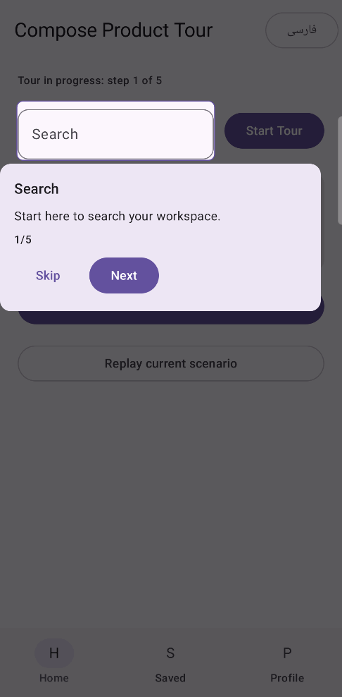

# Compose Product Tour

[](https://jitpack.io/#AmirNili/compose-product-tour)
[](LICENSE)


A modular, customizable product tour and coach marks library for Android apps built with Jetpack Compose. Public Kotlin packages use `io.github.amirnili.producttour`. Version `0.2.0` updates the package namespace from the initial placeholder namespace.

## Demo

<p align="center">
  
</p>

## Features

- Hoisted state with `start`, `next`, `previous`, `skip`, and `finish` actions.
- Lifecycle-aware target registration with `Modifier.tourTarget("id")`.
- Rectangle, rounded rectangle, and circular spotlights.
- Adaptive tooltip placement with RTL/LTR support.
- Custom overlay, spotlight, tooltip, typography, colors, shapes, and animations.
- Optional Material 3 tooltip adapter.
- Resource-backed text and accessibility semantics.
- No global mutable state; the core module has no Material dependency.

## Requirements

- Android API 24 or newer.
- Java 17 to run Gradle. Library bytecode targets Java 11.
- Jetpack Compose 1.9.5 (the version used to build this release).

## Installation

Add JitPack to the repositories in your root `settings.gradle.kts`:

```kotlin
dependencyResolutionManagement {
    repositories {
        google()
        mavenCentral()
        maven { url = uri("https://jitpack.io") }
    }
}
```

Add the modules you need to your app's `build.gradle.kts`:

```kotlin
dependencies {
    implementation("com.github.AmirNili.compose-product-tour:compose-product-tour-core:v0.2.0")
    implementation("com.github.AmirNili.compose-product-tour:compose-product-tour-ui:v0.2.0")
    // Optional Material 3 tooltip adapter:
    implementation("com.github.AmirNili.compose-product-tour:compose-product-tour-material:v0.2.0")
}
```

The UI module depends on core and animation. The Material module depends on core and UI. Add the animation module directly only if you use its API independently. The in-repository sample uses published artifacts by default; set `-PsampleUsePublishedProductTour=false` to build it against local modules before a release is available.

## Quick start

Create localized string resources for the step title and description, then define a step with the same ID as its target:

```kotlin
import androidx.compose.runtime.Composable
import androidx.compose.runtime.LaunchedEffect
import io.github.amirnili.producttour.core.model.SpotlightShape
import io.github.amirnili.producttour.core.model.TourStep
import io.github.amirnili.producttour.ui.ProductTour
import io.github.amirnili.producttour.ui.rememberProductTourState
import io.github.amirnili.producttour.ui.target.tourTarget

@Composable
fun SearchScreen() {
    val steps = listOf(
        TourStep(
            id = "search",
            titleResId = R.string.tour_search_title,
            descriptionResId = R.string.tour_search_description,
            spotlightShape = SpotlightShape.RoundedRectangle,
        ),
    )
    val tourState = rememberProductTourState()

    ProductTour(state = tourState, steps = steps) {
        SearchButton(Modifier.tourTarget("search"))
    }

    LaunchedEffect(Unit) {
        tourState.start()
    }
}
```

See [Getting Started](docs/getting-started.md) for imports, resources, and lifecycle details.

## Modules

| Module | Purpose |
| --- | --- |
| `compose-product-tour-core` | Models, state, target contracts, and positioning |
| `compose-product-tour-ui` | Compose container, overlay, spotlight, tooltip, and target integration |
| `compose-product-tour-animation` | Animation configuration |
| `compose-product-tour-material` | Optional Material 3 tooltip |
| `sample` | Runnable demonstration app |

## Documentation and project policies

| Guide | Description |
| --- | --- |
| [Getting Started](docs/getting-started.md) | Define steps, register targets, and control the tour |
| [Theming & Styles](docs/theming.md) | Configure overlays, tooltips, and visual styles |
| [Custom Spotlight](docs/custom-spotlight.md) | Customize spotlight rendering |
| [Custom Tooltip](docs/custom-tooltip.md) | Replace or style tooltip content |
| [API Design & Specifications](docs/api-design.md) | Public API contracts and design notes |
| [FAQ](docs/faq.md) | Common questions |
| [Known Issues](docs/known-issues.md) | Current limitations and workarounds |
| [Contributing](CONTRIBUTING.md) | Contribution workflow and validation |
| [Code of Conduct](CODE_OF_CONDUCT.md) | Community expectations |
| [Security](SECURITY.md) | Private vulnerability reporting guidance |

## Build and verify

```bash
./gradlew clean build
./gradlew test
./gradlew lint
```

## License

Distributed under the Apache License 2.0. See [LICENSE](LICENSE).
